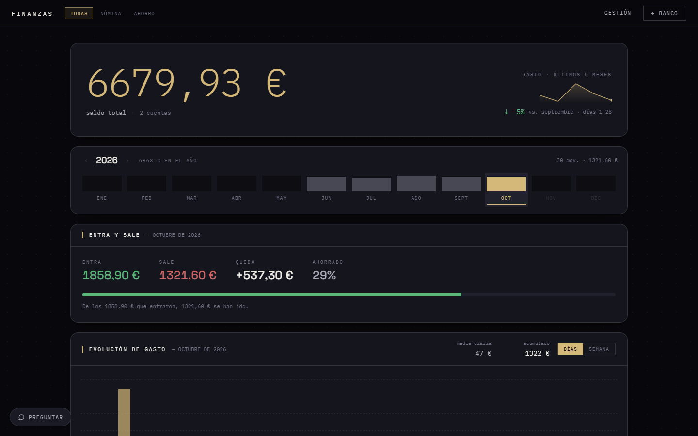
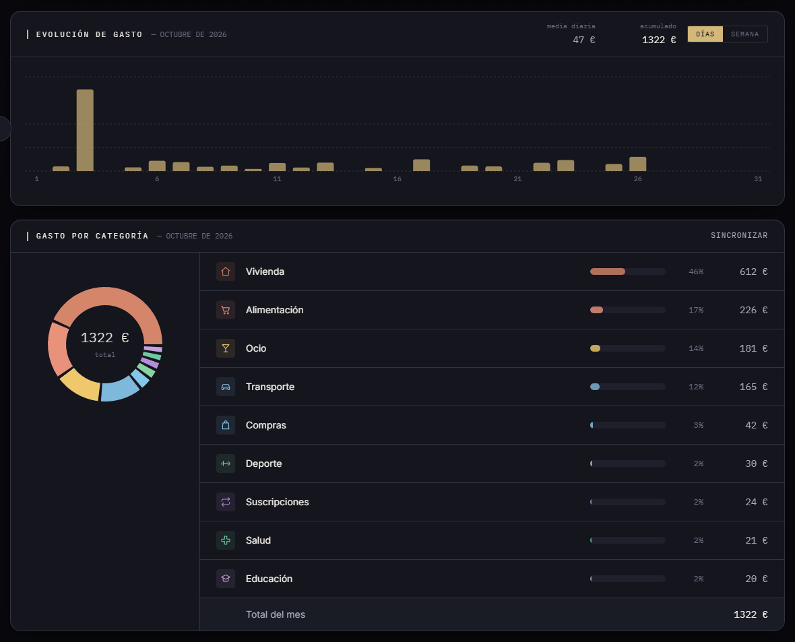
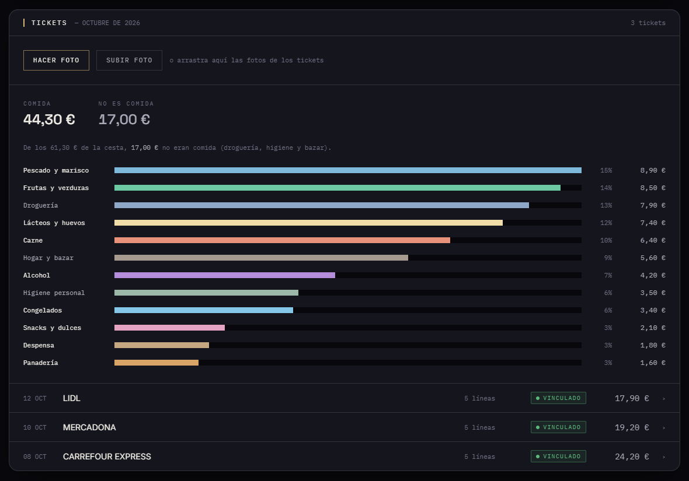
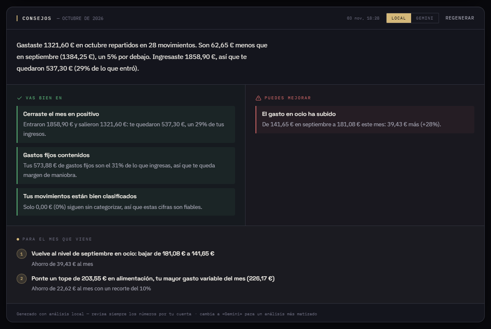
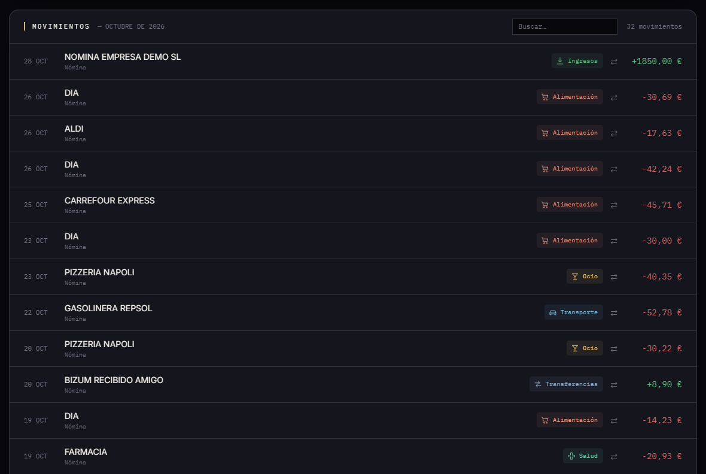
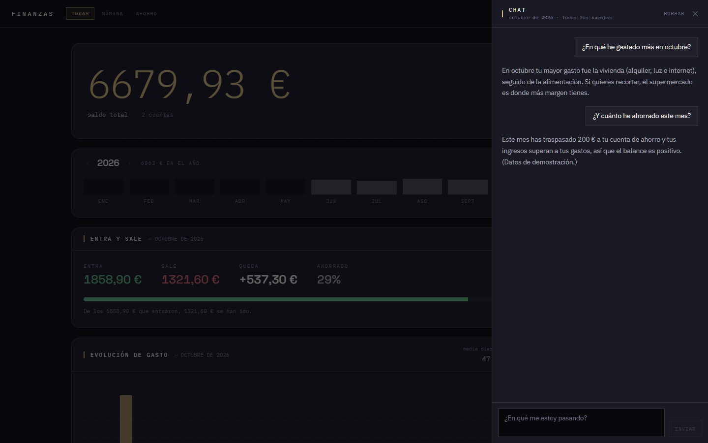
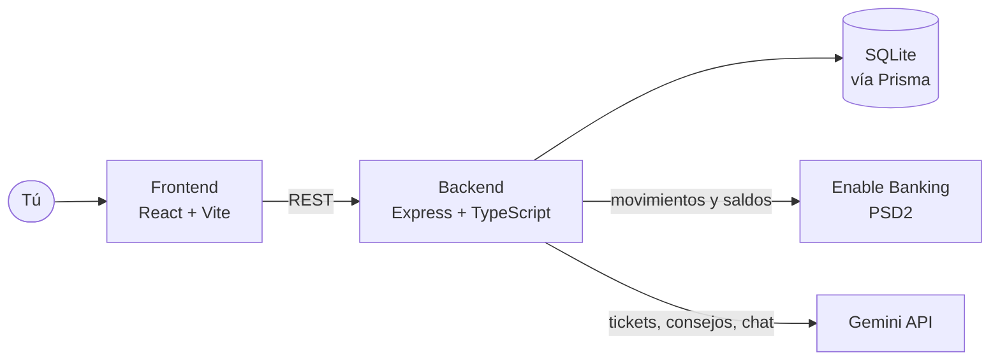

<div align="center">

# 💶 Finanzas App

**Tus gastos, claros. Con gráficas, tickets leídos por IA y consejos que salen de tus propios datos.**




<sub>Capturas con datos de demostración ficticios (ver [Probar la demo](#-probar-la-demo)).</sub>

</div>

---

## ✨ Qué hace

| | Función | En una línea |
|---|---|---|
| 📊 | **Panel de gastos** | Saldo total, entradas y salidas del mes, evolución diaria y reparto por categoría. |
| 🏦 | **Conexión bancaria** | Importa tus movimientos con [Enable Banking](https://enablebanking.com) (PSD2). |
| 🧾 | **Tickets con IA** | Fotografías un ticket y Gemini lo desglosa por productos y subcategorías. |
| 💡 | **Consejos** | Qué haces bien y qué puedes mejorar, con análisis local (gratis) o con Gemini. |
| 💬 | **Chat** | Pregúntale a tus datos: *«¿en qué me estoy pasando?»*. |
| 🏷️ | **Categorías propias** | Reglas que aprenden de tus correcciones y propuestas de la IA para lo que no reconoce. |
| 🔁 | **Gastos fijos y recurrentes** | Detecta suscripciones y recibos y te propone añadirlos. |
| ⇄ | **Varias cuentas** | Vista conjunta o por cuenta; los traspasos entre tus cuentas no cuentan como gasto. |

## 🖼️ Un vistazo

<details open>
<summary><b>Evolución y gasto por categoría</b></summary>



</details>

<details>
<summary><b>Tickets de compra desglosados</b></summary>



</details>

<details>
<summary><b>Consejos</b></summary>



</details>

<details>
<summary><b>Movimientos</b></summary>



</details>

<details>
<summary><b>Chat</b></summary>



</details>

## 🧩 Cómo está montado



- **`backend/`**: rutas (`routes/`) finas y lógica en servicios (`services/`): categorizador, lector de tickets, detector de traspasos y de recurrentes, consejos, chat.
- **`frontend/`**: React con TanStack Query y Recharts; el panel es una sola página con secciones.
- **Datos**: SQLite en desarrollo (PostgreSQL previsto para producción). Todo se queda en tu máquina.

## 🚀 Puesta en marcha

**Requisitos:** Node.js 18+ y [pnpm](https://pnpm.io) (`npm install -g pnpm`).

```bash
# Backend (puerto 3000)
cd backend
pnpm install
cp .env.example .env     # rellena tus valores
pnpm db:migrate          # crea la base de datos
pnpm db:generate
pnpm dev

# Frontend (puerto 5173), en otra terminal
cd frontend
pnpm install
pnpm dev
```

Abre <http://localhost:5173>.

### 🔐 Variables de entorno (`backend/.env`)

| Variable | Descripción |
|---|---|
| `DATABASE_URL` | Ruta a la base de datos SQLite (ej. `file:./dev.db`) |
| `PORT` | Puerto del backend (por defecto 3000) |
| `GEMINI_API_KEY` | Clave de la API de Gemini ([aistudio.google.com/apikey](https://aistudio.google.com/apikey)): consejos con IA y lectura de tickets |
| `ENABLE_BANKING_APP_ID` | ID de aplicación de Enable Banking |
| `ENABLE_BANKING_PRIVATE_KEY_PATH` | Ruta a la clave privada `.pem` de Enable Banking |
| `ENABLE_BANKING_REDIRECT_URL` | URL de vuelta del banco: el túnel de Cloudflare + `/callback` |
| `FRONTEND_URL` | A dónde redirige el backend tras conectar (por defecto `http://localhost:5173`) |
| `DEMO_MODE` | `1` para calcular los saldos desde los movimientos, sin banco (ver demo) |

## 🧪 Probar la demo

Sin banco ni claves: el script `db:seed` crea una base de datos **aparte** con 5 meses de movimientos ficticios, dos cuentas, tickets, gastos fijos y un chat de ejemplo. El script se niega a ejecutarse si `DATABASE_URL` no contiene `demo`, para no tocar nunca tus datos reales.

<details>
<summary><b>PowerShell</b></summary>

```powershell
cd backend
$env:DATABASE_URL = "file:./demo.db"
pnpm prisma migrate deploy
pnpm db:seed
$env:DEMO_MODE = "1"
pnpm dev
```

</details>

<details>
<summary><b>Bash</b></summary>

```bash
cd backend
export DATABASE_URL="file:./demo.db" DEMO_MODE=1
pnpm prisma migrate deploy && pnpm db:seed && pnpm dev
```

</details>

Con el frontend arrancado, los consejos del modo **Local** funcionan sin red. El chat y el modo Gemini necesitan `GEMINI_API_KEY`.

## 🏦 Conectar un banco

<details>
<summary><b>Túnel de Cloudflare y Enable Banking</b></summary>

Enable Banking exige que la URL de redirect sea **https pública**, y el backend corre en `localhost`. Se expone con un túnel rápido de Cloudflare, que genera un host **nuevo cada vez que se arranca**, así que hay que repetir los pasos 3 y 4 en cada conexión.

1. Backend en marcha: `cd backend; pnpm dev`.
2. En otra terminal: `cloudflared tunnel --url http://localhost:3000`. Devuelve una URL tipo `https://algo-aleatorio.trycloudflare.com`. Dejarla abierta.
3. Poner esa URL + `/callback` en `ENABLE_BANKING_REDIRECT_URL` (`backend/.env`).
4. Registrar la **misma URL exacta** en el panel de Enable Banking, en *Redirect URLs* de la aplicación. Si no coincide carácter a carácter, el banco rechaza la autorización.
5. Reiniciar el backend (el cambio de `.env` no lo recoge nodemon).
6. En el dashboard: **+ Banco** → elegir banco → consentir → vuelta automática.

Dos cosas que fallan a menudo:

- **Marcar la cuenta en la pantalla del banco.** La autorización puede salir válida y no traer ninguna cuenta si no se marca ninguna. Cuando pasa, el dashboard lo dice en rojo en vez de cantar victoria.
- **No reiniciar el backend entre "Conectar" y la vuelta del banco**: el token de estado vive en memoria y se perdería ("Unknown or expired state").

El consentimiento dura 90 días; al caducar, el dashboard avisa y hay que repetirlo.

</details>

## 📱 Desde el móvil (para fotografiar tickets)

<details>
<summary><b>Pasos</b></summary>

El frontend escucha en toda la red local y el cliente deduce la URL del backend del host desde el que se abre, así que basta con:

1. Averigua la IP local del PC: `ipconfig` → «Dirección IPv4» (ej. `192.168.1.42`).
2. Con el móvil en la misma wifi, abre `http://192.168.1.42:5173`.
3. En el apartado **Tickets**, «Hacer foto» abre directamente la cámara.

Si no carga, casi siempre es el firewall de Windows: hay que permitir Node.js en redes privadas, o abrir los puertos 5173 y 3000.

</details>

## 🗂️ Varias cuentas

<details>
<summary><b>Cómo se comporta</b></summary>

El panel principal siempre suma **todas** las cuentas. El apartado **Cuentas** muestra el reparto del mes (ingresos, gastos, neto y saldo de cada una) y permite abrir una sola: al hacerlo aparecen debajo su gasto por categoría, su evolución, sus tickets, sus consejos y sus movimientos, solo de esa cuenta.

- **Alias**: pulsando sobre el nombre de una cuenta se le pone el propio ("Nómina", "Ahorro"). Los bancos suelen no mandar nombre.
- **Traspasos entre cuentas propias**: se detectan solos al sincronizar (importes opuestos, cuentas distintas, ±3 días, ±0,02 €) y quedan fuera de gastos e ingresos, porque el dinero no sale del patrimonio. En la lista de movimientos salen marcados «⇄ Traspaso» y se pueden corregir a mano; una vez corregidos, el detector automático ya no los toca.
- **Gastos fijos** no están repartidos por cuenta: son siempre globales, y por eso los consejos de una cuenta concreta no los tienen en cuenta.
- **Tickets en efectivo** no tienen movimiento y por tanto no tienen cuenta: solo aparecen en la vista global.

</details>

## 🔒 Privacidad

Es una app personal y de un solo usuario. Los movimientos, las claves del banco y las fotos de tickets **nunca salen de tu máquina** ni se suben al repositorio: el `.gitignore` deja fuera `.env`, las claves `.pem`, las bases de datos y `backend/uploads/`. Lo único que viaja fuera es lo que se envía a Gemini cuando pides un consejo, una lectura de ticket o un mensaje de chat.

## 🗺️ Hoja de ruta

- [x] Panel con gráficas de gasto por mes, día y categoría
- [x] Conexión con Enable Banking y varias cuentas
- [x] Detección de traspasos entre cuentas propias
- [x] Gastos fijos y detección de recurrentes
- [x] Lectura de tickets con IA y desglose por subcategorías
- [x] Consejos (análisis local y Gemini) y chat
- [x] Modo demo con datos ficticios
- [ ] Despliegue con PostgreSQL
- [ ] Alertas y objetivos de ahorro
- [ ] Renovación guiada del consentimiento bancario

## 📄 Licencia

[MIT](LICENSE) © 2026 Joel Morera Apaza
